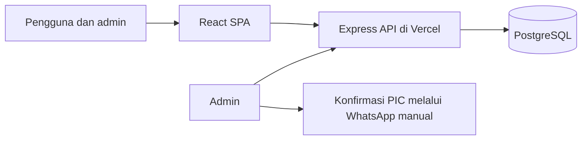

# Arsiva

**Digitalisasi peminjaman inventaris dan ruangan sekolah.**

Arsiva dirancang untuk menyederhanakan pengajuan, pemantauan, persetujuan, dan pengembalian aset sekolah melalui satu aplikasi web.

## Latar belakang

Proyek ini berangkat dari pengalaman pengembang saat sekolah: peminjaman barang mengharuskan siswa mendatangi bagian kesiswaan, menunggu petugas tersedia, mencatat identitas, dan menandatangani formulir secara manual. Arsiva menawarkan alur digital agar pengguna dapat mengajukan peminjaman dan memantau status tanpa harus menunggu di tempat hanya untuk mengisi formulir.

## Fitur utama

- Katalog barang dan ruangan dengan informasi ketersediaan.
- Pengajuan peminjaman barang secara online, peninjauan admin, dan pencatatan pengembalian.
- Pengajuan peminjaman kelas berdasarkan jadwal, dengan pemeriksaan bentrok dan konfirmasi PIC sebelum keputusan akhir admin.
- Pemantauan status, riwayat, dan notifikasi peminjaman.
- Pengelolaan inventaris dan akun berdasarkan peran.

## Tech stack

| Komponen | Teknologi |
| --- | --- |
| Frontend | React 18, Vite 5, Tailwind CSS 3, React Router 6 |
| Backend | Express 4, Node.js 20 atau lebih baru |
| Database | PostgreSQL |
| Autentikasi | JWT, bcryptjs |
| Deployment | Vercel |

## Arsitektur



Frontend dan API menggunakan satu proyek Vercel. Diagram bersifat konseptual. Konfirmasi WhatsApp menggunakan tautan pesan yang dikirim manual oleh admin; keputusan PIC dicatat oleh admin, bukan webhook otomatis.

## Alur peminjaman

**Barang:** pilih barang dan jumlah, ajukan permintaan, tunggu keputusan admin, lalu catat pengembalian. Stok diperbarui pada persetujuan dan pengembalian.

**Ruangan:** pilih ruangan dan jadwal, isi keperluan, tunggu admin menghubungi PIC, lalu admin mencatat keputusan PIC dan memutuskan permintaan. Fitur ini membutuhkan skema Arsiva v1.1.

Frontend (React + Vite + Tailwind) dan API (Express + PostgreSQL) sekarang **satu proyek**, jadi cukup satu kali deploy ke Vercel.

```
api/index.js      pintu masuk serverless Vercel (membungkus server/app.js)
server/           API Express: routes, middleware, koneksi database
src/              aplikasi React
db/schema.sql     skema untuk database baru
db/upgrade-dari-versi-lama.sql   untuk database proyek lama (dari pinjam.dump)
scripts/create-admin.js          membuat akun admin pertama
```

## Deploy ke Vercel

Vercel tidak punya database sendiri yang bisa dipakai langsung dari proyek lama (Postgres lokal tidak bisa diakses dari internet), jadi siapkan dulu database PostgreSQL online. Neon dan Supabase punya paket gratis. Atau di Vercel: Storage → Marketplace → Neon.

**1. Siapkan database**

Pilih salah satu:

- **Database baru (kosong):**
  `psql "$DATABASE_URL" -f db/schema.sql`
- **Mau membawa data lama** (dari `db/pinjam.dump`):
  ```
  pg_restore --no-owner --no-privileges -d "$DATABASE_URL" db/pinjam.dump
  psql "$DATABASE_URL" -f db/upgrade-dari-versi-lama.sql
  ```
  Password lama yang masih berupa teks polos otomatis di-hash saat pemiliknya berhasil masuk.

Untuk fitur peminjaman kelas v1.1, tinjau dan terapkan migrasi `db/arsiva-v1.1-neon.sql` pada database yang sesuai setelah membuat cadangan dan menguji di lingkungan terisolasi.

**2. Buat admin pertama**

```
npm install
npm run create-admin -- "Nama Admin" "password-kuat" --super
```
(isi `DATABASE_URL` di file `.env` dulu, lihat `.env.example`)

**3. Upload ke Vercel**

Push folder ini ke satu repo GitHub, lalu *Add New Project* di Vercel dan pilih repo itu. Preset Vite terdeteksi otomatis. Tambahkan dua Environment Variable:

| Nama | Isi |
|---|---|
| `DATABASE_URL` | connection string PostgreSQL (dengan `sslmode=require`) |
| `JWT_SECRET` | string acak panjang (`node -e "console.log(require('crypto').randomBytes(48).toString('hex'))"`) |

Klik Deploy. Frontend dan `/api/*` berjalan di domain yang sama, jadi tidak perlu CORS atau `FRONTEND_URL`.

> `db/pinjam.dump` berisi data pengguna lama. Sudah masuk `.gitignore`; jangan di-push ke repo publik.

## Jalan di komputer sendiri

```
cp .env.example .env     # isi DATABASE_URL dan JWT_SECRET
npm install
npm run dev              # web di :5173, API di :3001 (otomatis diproxy)
```

## Peran

| Peran | Bisa |
|---|---|
| `USER` (siswa) | lihat katalog, ajukan dan batalkan permintaan, lihat riwayat dan notifikasi sendiri, catat pengembalian miliknya |
| `ADMIN` | semua milik siswa, plus setujui/tolak permintaan, kelola barang dan ruangan, lihat seluruh riwayat |
| `SUPER ADMIN` | semua milik admin, plus menambah admin lewat `POST /api/users/admin` |

Pendaftaran lewat halaman daftar selalu menghasilkan `USER`.

## Catatan teknis

- Stok berkurang sebanyak jumlah yang diminta saat disetujui, dan pulih sebanyak itu saat dikembalikan. Stok dicek saat mengajukan dan saat menyetujui.
- Semua perubahan multi-langkah (setujui, tolak, kembalikan) berjalan dalam satu transaksi database.
- Kolom `kembali` dari skema lama tidak dipakai lagi; batas pengembalian kini ada di `pinjam.jatuh_tempo`.
- Token login berlaku 7 hari menurut dokumentasi sebelumnya. Keluar = hapus token di browser.
- Pemeriksaan kesehatan dasar tersedia melalui `/api/health`; responsnya bukan bukti bahwa koneksi database sehat.

## Pemeriksaan build

Jalankan `npm run build` untuk membangun frontend. Pada `package.json` yang ditinjau belum tersedia script lint atau test otomatis.

## Privasi dan keamanan

Jangan menyertakan data siswa, dump database asli, atau kredensial dalam repo maupun demo publik. Gunakan data fiktif untuk demonstrasi dan simpan konfigurasi rahasia di environment variables. Dokumentasi ini bukan hasil audit keamanan menyeluruh.
